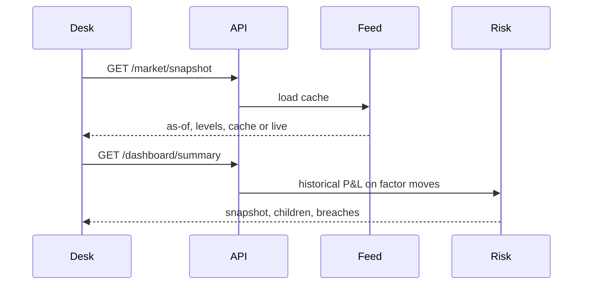
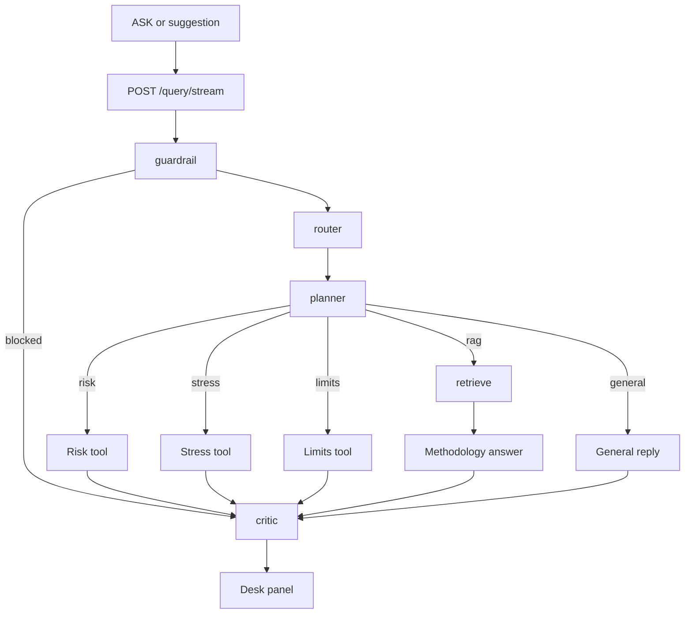

# QuantAgent-Desk action flows

How a click or a question moves through the desk. Paths below are the ones the terminal and the API actually run.

## 1. Open the terminal

`ui/app.py` starts, seeds session state, and draws the masthead.

1. `GET /market/snapshot`. The API calls `load_market_snapshot`. The local fallback does the same if port 8000 does not answer.
2. The feed reads `data/market/factors.csv`, keeps rows on or before 2026-10-27, and returns the last levels plus `source: cache`. A missing cache with the offline flag unset downloads and returns `source: live`. Offline with no cache returns 503 from the API, or `available: false` from the local backend. The strip stays empty and VaR falls back to the synthetic path.
3. `GET /dashboard/summary?portfolio_id=FIRM` (or the selected book).
4. The portfolio engine flattens that node. `MarketRiskEngine.from_portfolio_positions` builds one P&L vector from the factor moves and registers a snapshot. `LimitsEngine.check` attaches utilization and any warning or breach.
5. Child desks are flattened and valued the same way so the table and bar chart have one row each.
6. The page paints the factor strip, the four KPIs, the tape, the risk and limits panels, and the stress lab. Stress chips read the same snapshot levels and do not change the stored shocks.

Changing **BOOK** or pressing **REFRESH** reruns the script from step 1. A stress result is cleared when the book changes.



## 2. Ask the desk

The command line and the suggestion buttons call `POST /query/stream` with the query, the selected book, and the session id. The local fallback calls `stream_graph` in-process. Events are `node_update`, `token`, `final`, and `error`. The panel shows node codes while the graph runs, then the answer.

`POST /query` is the same graph without the event stream. Evals and `backend_local.query_desk` use it.

### Graph

1. **Guardrail.** `policies.yaml` rejects trade execution, orders, wires, passwords, and API keys. A blocked question skips the tools. The critic returns the off-scope message.
2. **Router.** Keyword rules, first match wins:
   - stress, scenario, crisis, shock, 2008, COVID, GFC → `stress`
   - limit, breach, warning, utilization → `limits`
   - VaR, ES, or "expected shortfall", unless the question asks what something is → `risk`
   - what is, explain, how, methodology, definition → `rag`
   - anything else → `general`
3. **Planner.** Research is on only for `rag`. Risk, stress, and limits set `do_research` false and skip retrieval.
4. **One tool.**
   - **Risk.** Flatten the book, run `from_portfolio_positions`, check limits, append the calculation id, and write the snapshot text.
   - **Stress.** Historical phrases select a stored scenario. "Generate", "AI bubble", "stagflation", and the other narrative phrases call `GenerativeStressAgent`. That agent uses Ollama, or the template shocks when the LLM is disabled or unavailable. `apply_stress` then values the book. The base VaR is a fresh historical snapshot, so the stress result carries its own calculation id.
   - **Limits.** Value the book, then report utilization from `LimitsEngine`.
   - **RAG.** Answer from the retrieved methodology passages and keep their source names as citations.
   - **General.** A short scope reminder. No calculation.
5. **Critic.** Money and utilization in the answer must match the registered calculation within 0.5%. Unmatched figures are removed. Methodology answers need a citation. Warnings are returned with the answer.
6. The session stores the user turn and the assistant turn. Risk and stress tools also append an episode.



## 3. Historical VaR

Used by the dashboard, the risk route, and the risk and stress tools.

1. If the caller passed a factor panel, use it. A panel whose SPX column looks like prices is converted to moves. Tests use this and do not touch the network.
2. Otherwise load the cache. Equity, FX, and WTI enter as percent changes. The 10Y and the OAS enter as daily differences of decimal levels. Rows that are missing any P&L factor are dropped. VIX is not in the move panel.
3. For each position, add `sign × notional × sensitivity × that factor's move` onto one vector. Unmapped asset classes are skipped. If nothing maps, or there are fewer than ten moves, use 500 seeded normal shocks and set methodology to `Synthetic`.
4. Sort the P&L worst-first. VaR 95 is the loss at index `floor(0.05 × n)`. VaR 99 uses `0.01`. ES 97.5 is the mean loss of the tail at `0.025`.
5. Methodology on the historical path is `Historical factors as of YYYY-MM-DD`, using the last date in the aligned panel.
6. `get_registry().register` stores the snapshot under a new calculation id.

Worked shape, which the fixture test locks: one long equity position, notional 1,000,000, sensitivity 0.01, twenty ordered SPX moves from −5% to +14%. P&L is −500 through +1,400. VaR 95 is 400. The same position Short has VaR 95 of 1,300, and its P&L is the exact negation.

## 4. Run a stress from the panel

1. `GET /stress/historical` fills the scenario list.
2. Chips render the stored shock. If the factor snapshot has a level for that name, the chip also shows the Oct 2026 spot. `CDX_IG` reads the IG OAS level. The shock value is unchanged.
3. **RUN STRESS** calls `POST /stress/run?scenario_id=...&portfolio_id=...`.
4. The engine flattens the book, takes a base VaR, and applies each shock to positions whose asset class maps to that factor. Relative shocks scale notional × sensitivity × shock. Absolute shocks use an extra ×100 scaling.
5. The result stays on the panel until the book changes. Its calculation id is the stress result id, not the base VaR id.

A typed "Run the 2008 GFC stress" does not use this button. It goes through the graph in section 2 and lands in the same `apply_stress`.

## 5. Refresh the factor cache

```bash
PYTHONPATH=src python scripts/refresh_market_data.py --as-of 2026-10-27
```

1. Refuse immediately when `QUANTAGENT_MARKET_OFFLINE=1`. The exit code is 2 and the CSV is left as it is.
2. Download SPX, VIX, EURUSD, and WTI, then FRED `DGS10` and `BAMLC0A0CM`. Yields and the OAS are divided by 100 so the file stores decimals.
3. Inner-join the columns, drop incomplete sessions, and keep the last 253 levels on or before the as-of date. That is about 252 daily moves.
4. Rewrite `data/market/factors.csv`.

The desk does not call this script. It only reads the file. CI sets the offline flag so the suite never calls Yahoo or FRED.

## 6. Evaluate

`scripts/run_evals.py` and `GET /eval/run` call `run_eval_suite`. Each case is routed, then `build_and_run` on book `FIRM`. A case passes when intent, grounding, keywords, and the calculation-id expectation match. Dollar amounts may move when the factor cache changes. The numeric check only requires that the figures in the answer belong to the calculation that produced them.
