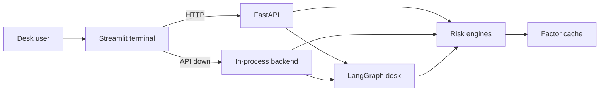
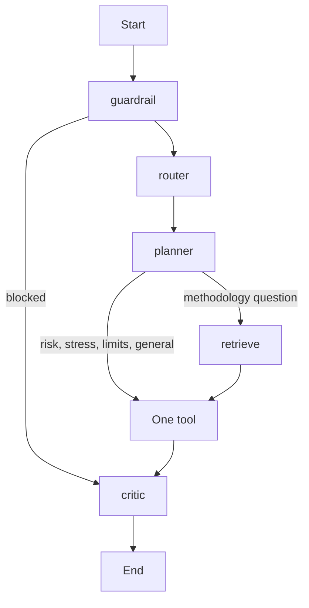

# QuantAgent-Desk architecture

Local risk terminal. A Streamlit desk shows one book at a time. Numbers come from in-process engines. A LangGraph pipeline answers natural-language questions and will not emit a dollar figure that is not tied to a calculation.

The books are synthetic. The market behind VaR is a committed factor cache pinned to 27 Oct 2026.

## Runtime

Two processes, either of which can serve the desk:

| Process | Entry | Port |
|---------|--------|------|
| API | `quantagent_desk.api.main:app` | 8000 |
| Desk | `quantagent_desk.ui.app` | 8501 |

`run.bat` and `run.sh` start both. The desk calls `http://localhost:8000` first. If that call fails, `ui/app.py` switches to `ui/backend_local.py` for the rest of the Streamlit session and runs the same engines in-process. Streamlit Community Cloud uses that fallback alone via `streamlit_app.py`.



## Layers

```
src/quantagent_desk/
  ui/            Streamlit terminal and the local fallback
  api/           FastAPI routes
  agents/        Compiled LangGraph: guardrail, router, planner, one tool, critic
  engines/       Portfolio, VaR, stress, limits, calculation registry
  marketdata/    Pinned factor history
  models/        Pydantic books, snapshots, shocks, queries
  rag/           Methodology retrieval
  memory/        Session turns, entities, episodes
  guardrails/    policies.yaml plus the validator
  evals/         Five-case accuracy gate and lexical RAGAS
  utils/         Token clipping and local traces
```

### Desk

`ui/app.py` is one screen: factor strip, book selector, VaR and ES, limit bars, stress lab, and the command line. It does not recompute risk. It calls the API, or the local backend, and renders the JSON.

### API

`api/main.py` holds one `PortfolioEngine`, `MarketRiskEngine`, `StressEngine`, and `LimitsEngine` for the process. Startup builds the synthetic firm. Routes:

| Route | Role |
|-------|------|
| `GET /health` | Liveness |
| `GET /market/snapshot` | As-of date, last factor levels, `cache` or `live` |
| `GET /dashboard/summary` | Flattened book, VaR snapshot, child desks, breaches |
| `GET /risk/snapshot/{portfolio_id}` | VaR and ES only |
| `GET /stress/historical` | 2008, 2020, and 2022 scenarios |
| `POST /stress/run` | Apply one historical scenario |
| `POST /query` | Full desk answer |
| `POST /query/stream` | Same graph as server-sent events |
| `GET /eval/run` | Eval suite |
| `GET /traces/recent` | Clipped local spans |

### Books

`PortfolioEngine.create_synthetic_firm` builds Firm → three desks (Rates, FX, Equity) → two books each → three positions each. Notionals, direction, and sensitivity are seeded. Positions stay in memory for the process lifetime.

A risk or stress call flattens the selected node with `flatten_positions` and wraps those positions in a temporary portfolio. The firm snapshot is the sum of position P&L on one shared factor path, not the sum of the three desk VaRs.

### Market data

`marketdata/feed.py` reads `data/market/factors.csv` first. The file is daily levels through the last session on or before **2026-10-27**:

| Column | Source | Use |
|--------|--------|-----|
| SPX | Yahoo `^GSPC` | Equity P&L, percent change |
| VIX | Yahoo `^VIX` | Strip only |
| EURUSD | Yahoo `EURUSD=X` | FX P&L, percent change |
| WTI | Yahoo `CL=F` | Commodity P&L, percent change |
| USD_10Y | FRED `DGS10` | Rates P&L, daily change in decimal yield |
| IG_OAS | FRED `BAMLC0A0CM` | Credit proxy for CDX IG, daily change in decimal spread |

`scripts/refresh_market_data.py --as-of 2026-10-27` rewrites the cache. Yahoo is read with yfinance when this interpreter can verify TLS, and with the public chart endpoint otherwise. FRED is a public CSV. `QUANTAGENT_MARKET_OFFLINE=1` refuses both networks. CI sets that flag so tests use the committed file.

If the cache cannot supply at least ten aligned moves, `MarketRiskEngine` keeps the seeded normal simulation and labels the snapshot `Synthetic`.

### VaR and ES

`MarketRiskEngine.historical_var_es` sorts a 1-day P&L vector and reports VaR 95, VaR 99, and ES 97.5 as positive loss numbers. Historical P&L for a position is:

```
sign(direction) * notional * sensitivity * factor_move
```

Long and Receive keep the factor move. Short and Pay flip it. Rates map to `USD_10Y`, FX to `EURUSD`, equity to `SPX`, credit to `IG_OAS`, commodities to `WTI`. Every position in the book is added onto that same date index.

Each snapshot is stored in `engines/registry.py` under its `calculation_id`. The guardrail later checks answer figures against that record.

`LimitsEngine` divides VaR, ES, peak PFE, and CVA by fixed USD limits. Utilization at or above 80% is a warning. At or above 100% it is a breach.

### Stress

`StressEngine` keeps three hand-set scenarios: 2008 GFC, COVID March 2020, and the 2022 rates shock. Shocks are not refit to the Oct 2026 spot. The desk only prints that spot beside the chip.

`apply_stress` is a linear sensitivity on the same asset-class map. Generative questions go through `engines/generative_stress.py`. Ollama proposes shocks when it is running. `QUANTAGENT_DISABLE_LLM=1`, or a missing model, uses the built-in templates. Policy caps live in `guardrails/policies.yaml` (equity shock size, rate shock in basis points, grounded sources).

### Desk graph

`agents/graph.py` compiles one LangGraph. State is the query, book id, intent, retrieved passages, snapshot, stress result, calculation ids, and the answer. A `MemorySaver` checkpointer keys on `session_id`. If LangGraph cannot compile, `_run_inline` runs the same nodes in order.



The planner turns research on only for intent `rag`. Risk, stress, and limits do not pull methodology pages.

### Retrieval, memory, guardrails, traces

- `rag/retriever.py` searches `data/docs` with Chroma when embeddings are available, and a keyword fallback otherwise. `QUANTAGENT_SKIP_EMBEDDINGS=1` forces the keyword path. Passages are clipped to a token budget.
- `memory/manager.py` keeps the last 20 turns per session, a small entity map, and an episode list of calculations and stress runs. It is process memory.
- `guardrails/validator.py` loads `policies.yaml`. Input policy blocks orders, wires, passwords, and API keys. The critic drops monetary figures and utilization that do not match a registered calculation within 0.5%, and requires a citation on methodology answers.
- `utils/tracing.py` records a local span tree. Langfuse or Phoenix export is off unless the corresponding environment variables are set. `/traces/recent` returns the clipped local tree.

### Evaluation

`evals/suite.py` runs five queries through `build_and_run`: firm VaR, 2008 stress, an Expected Shortfall definition, limits, and a generative AI-unwind stress. The gate checks intent, grounding, keywords, and whether a calculation id is present. It does not pin dollar levels. `evals/ragas_eval.py` scores faithfulness and numeric grounding lexically unless `QUANTAGENT_RAGAS_LEXICAL=0`.

## What is shared, and what is not

The API process and the Streamlit fallback each construct their own engines, graph, portfolio, and registry. A calculation id from a local answer is not in the API registry, and the reverse. The factor CSV is the shared market. The synthetic book is rebuilt from the same seed on each process start, so the positions match even though the objects do not.

Traces, session turns, and the calculation registry disappear when the process exits.
